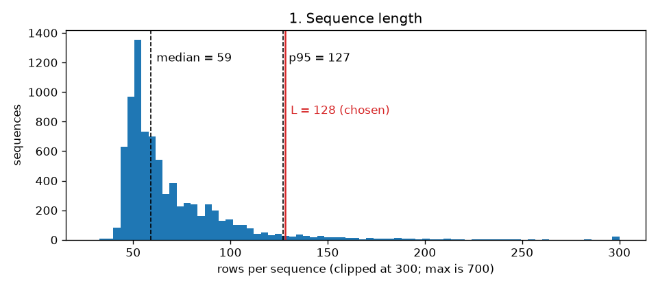
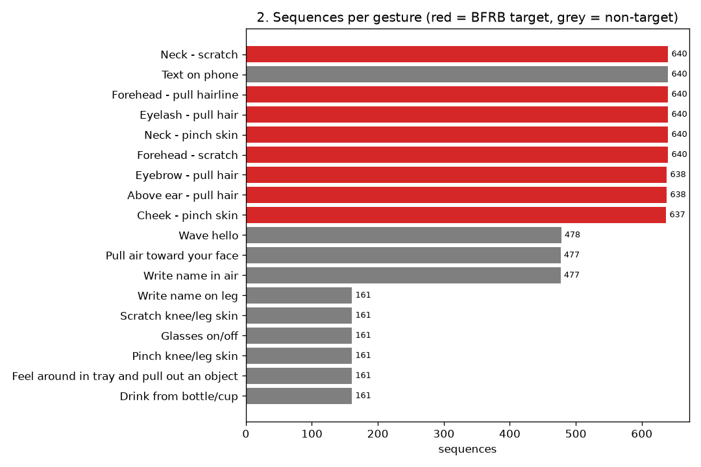
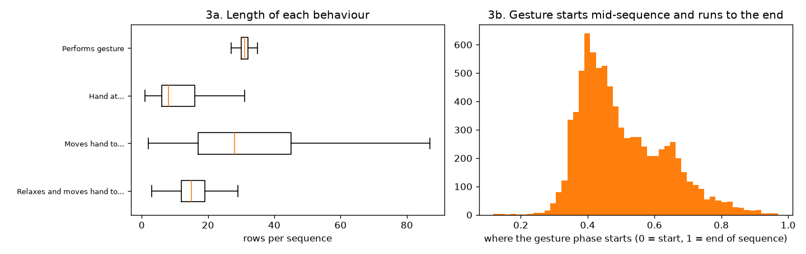
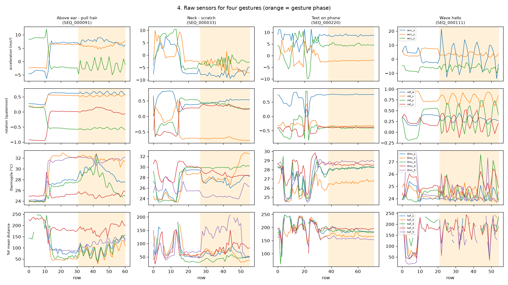
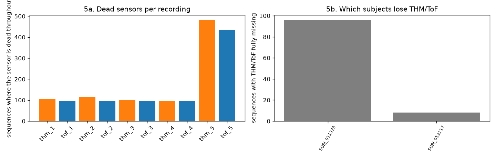
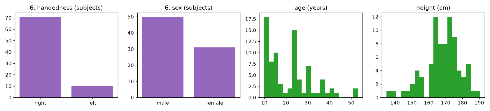
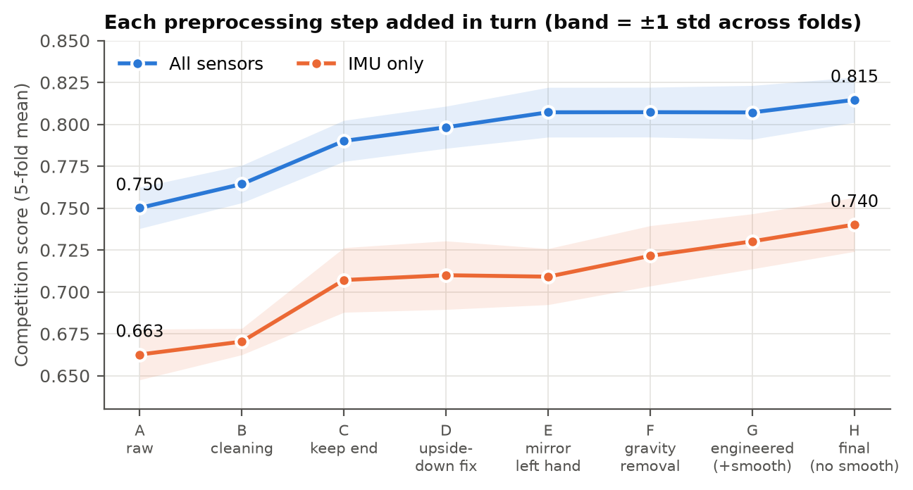
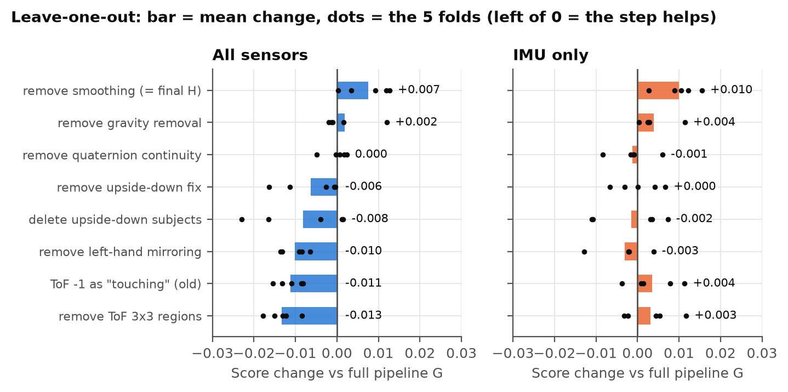

# SC4000 · CMI – Detect Behavior with Sensor Data

NTU SC4000 group project on the Kaggle competition *CMI – Detect Behavior with Sensor Data*.
A wrist device (Helios) records motion, temperature and distance while a person performs one of
18 gestures. The task is to tell **body-focused repetitive behaviours (BFRBs)**, such as hair
pulling or skin pinching, apart from everyday gestures, and to name which BFRB it is.

This repository holds the **data exploration and preprocessing**: one tested pipeline that turns a raw
recording into clean, orientation-corrected features, plus the built dataset the modelling team
trains on. The same `preprocess()` function runs in training and inside the Kaggle `predict()` call.

**Contents**
1. [Repository layout](#1-repository-layout)
2. [Setup and data](#2-setup-and-data)
3. [Exploratory data analysis](#3-exploratory-data-analysis)
4. [Preprocessing pipeline](#4-preprocessing-pipeline)
5. [Features](#5-features)
6. [Labels, folds and fixed length](#6-labels-folds-and-fixed-length)
7. [Augmentation (for training)](#7-augmentation-for-training)
8. [Results: what each step is worth](#8-results-what-each-step-is-worth)
9. [Checks](#9-checks)
10. [What the modellers get](#10-what-the-modellers-get)
11. [Rebuilding everything](#11-rebuilding-everything)
12. [History and credit](#12-history-and-credit)

---

## 1. Repository layout

```
eda/
  01_explore_data.py          answers the six EDA questions (section 3), saves figures
preprocessing/                the pipeline, one job per file
  constants.py                  column names, gesture lists, sensor constants
  data_loading.py               reads the Kaggle ZIP or extracted CSVs
  quaternion.py                 rotation maths (rotate, conjugate, 6D, angular velocity)
  cleaning.py                   order rows, fill gaps, quaternion continuity, ToF -> proximity
  orientation.py                fix upside-down wearers, mirror left-handers (all sensors)
  features.py                   gravity removal, jerk, angular velocity, ToF/THM summaries
  labels.py                     gesture / 9-class / binary / phase / orientation labels, metric
  shaping.py                    fixed length + mask, tree summaries, scalers, subject folds
  augmentation.py               training-only augmentations
  pipeline.py                   preprocess(sequence, demographics): the single entry point
  dataset.py                    runs the pipeline over the whole training set
  ablation.py                   the ablation variants A-H and leave-one-out
scripts/                      run in this order
  01_verify_physics.py          tests every physical assumption on the real data
  02_build_dataset.py           builds processed/
  03_parity_check.py            proves the Kaggle path gives identical output to training
  04_ablation_study.py          measures what each preprocessing step is worth
  05_report_figures.py          draws the result figures into docs/figures/results/
  06_quality_checks.py          22 checks on the finished processed/ folder
  07_build_report_pdf.py        builds docs/Preprocessing_Report.pdf
  tools/make_synthetic_data.py  fake data with known answers, used by the tests
tests/
  test_preprocessing.py         33 tests for the pipeline
  test_legacy_cleaning.py       11 tests for the original cleaning in legacy/
legacy/                       the first cleaning version (kept for credit and comparison)
docs/
  Preprocessing_Report.pdf      full write-up with figures
  CMI_Team_Guide_Preprocessing.pdf  the team plan the pipeline follows
  figures/eda/                  EDA figures (section 3)
  figures/results/              ablation and verification figures (section 8)
processed/                    built dataset (small files in git, large arrays in the Release)
data/                         competition ZIP (not in git)
outputs/                      logs, ablation caches, JSON results (not in git, rebuilt by scripts)
```

## 2. Setup and data

```powershell
python -m venv .venv
.\.venv\Scripts\python.exe -m pip install -r requirements.txt
```

On the shared Windows machine use `C:\Python313\python.exe` to create the venv. Plain `py` there is the
experimental free-threaded build, which cannot install numpy.

**Raw data** is not in the repository (Kaggle's rules do not allow redistributing it). Download it once:

```powershell
kaggle competitions download -c cmi-detect-behavior-with-sensor-data -p data
```

or download the ZIP from the competition page and put it at
`data/cmi-detect-behavior-with-sensor-data.zip`. Do not extract it; the code reads the ZIP directly.

**Built data** (`processed/`): the small files (`sequences.csv`, `folds.csv`, `meta.json`, `scalers/`,
`tree_full.parquet`, `tree_imu.parquet`) are committed. The large arrays (`features.npz`, `canonical/`,
about 750 MB) are too big for git. Download `processed_full.zip` from the repository's **Releases** page
and unzip it in the repository root, or rebuild it with `scripts/02_build_dataset.py` (about 4 minutes).

## 3. Exploratory data analysis

`eda/01_explore_data.py` answers six questions on the full training set. Figures are in
`docs/figures/eda/` and every number is saved to `outputs/eda/summary.json`.

### 3.1 Size and structure

| | |
|---|---|
| Sequences (recordings) | **8,151** |
| Rows (time steps, 10 Hz) | **574,945** |
| Subjects | **81** (median 102 sequences each) |
| Gestures | 18 (8 target BFRBs, 10 non-target) |
| Body positions (`orientation`) | 4 |
| Sequence length | min **29**, median **59**, mean 70.5, p95 **127**, p99 210, max **700** rows |

Only 4.9% of sequences are longer than 128 rows, so the fixed length for neural networks is **L = 128**.
It keeps 95% of recordings whole, and the long ones are cut from the start (the gesture is at the end, see 3.3).



### 3.2 Labels

- **5,113 target** (BFRB) sequences and **3,038 non-target** sequences.
- The 8 target gestures are almost perfectly balanced: 637 to 640 each. The rarest is
  *Cheek – pinch skin* (637). **No target gesture is rare**, so the macro F1 is not dominated by a tiny class.
- The imbalance is among the non-targets. Six of them have only 161 sequences each, while
  *Text on phone* has 640. For the score this matters less, because all 10 non-targets are merged into
  one "non_target" class (section 6).



### 3.3 Behaviour phases

Every sequence follows the same script. Median rows per sequence for each behaviour:

| Order | Behaviour | Median rows | Phase label |
|---|---|---|---|
| 1 | *Relaxes and moves hand to target location* (4,049 seqs) **or** *Moves hand to target location* (4,102 seqs) | 15 / 28 | transition |
| 2 | *Hand at target location* | 8 | pause |
| 3 | *Performs gesture* | 31 | gesture |

- The gesture makes up 44.5% of all rows. It starts at the **middle** of the sequence (median 47%,
  10–90% range 37–68%) and **runs to the end in 99.99% of sequences**. Only one sequence has no gesture rows.
- So yes, the actual gesture is the last part. The pipeline uses this in three ways: padding and truncation
  keep the end, the tree models get extra statistics over the last 25% of the recording, and a per-row
  phase label is provided for an auxiliary loss. Keeping the end alone added **+0.026–0.037 F1** (row C in section 8).
- The two possible first behaviours give each recording an "initial state" label (relaxed vs ready).



### 3.4 Sensors

Each row has an accelerometer (`acc_x/y/z`, m/s²), a rotation quaternion (`rot_w/x/y/z`), 5 thermopiles
(`thm_1..5`, °C) and 5 time-of-flight sensors (`tof_1..5`, 8×8 = 64 distance pixels each). One sequence
for each of four gestures:



**Can you see differences by eye? Yes, mostly in the gesture phase (orange):**
- *Wave hello*: large regular oscillation on acceleration and rotation. Easy to spot.
- *Text on phone*: almost flat. The hand is held still, and thermopile/ToF are steady because nothing is close.
- *Above ear – pull hair* and *Neck – scratch*: small fast oscillations while the hand stays in one place.
  The two look alike on the IMU, but the **thermopiles jump to skin temperature (about 30–32 °C)** and the
  **ToF distances drop** because the hand is next to the body. That is exactly the information lost in the
  IMU-only half of the test set, which is why BFRB vs BFRB is the hard part.
- The level of the raw acceleration differs between sequences purely because of posture (gravity points
  along a different axis). This motivates gravity removal (section 4).

### 3.5 Missing data

| Sensor | Rows with any NaN | Sequences missing the whole group | Partly missing |
|---|---|---|---|
| Acceleration | 0% | 0 | 0 |
| Rotation | 0.64% | 50 | 0 |
| Thermopile | 6.1% | 104 | 0 |
| ToF | 5.2% | 96 | 0 |

- Missing data is **all or nothing per recording**: a sensor is either there for the whole recording or
  absent for all of it. There are no gaps in the middle to repair.
- **Single sensors** are also often dead for a whole recording, especially sensor 5: `thm_5` in 482
  sequences and `tof_5` in 434 (the others in about 96–116).
- **Who:** the fully missing THM/ToF recordings come from just two subjects, **SUBJ_011323** (96 sequences,
  all of them) and **SUBJ_053217** (8).
- **ToF `-1`:** 57.5% of all ToF pixels are `-1`, meaning "nothing in range". This is a reading, not a
  missing value (section 4).
- **Link to the test set:** about half of the hidden test set is IMU-only (thermopile and ToF switched
  off), but in training only about 1% of sequences look like that. A model trained naively would barely see
  the IMU-only situation. The fix is to blank THM/ToF at random during training (section 7) and to score
  every experiment twice, with all sensors and IMU-only (section 8).



### 3.6 Demographics

| | |
|---|---|
| Handedness | **71 right, 10 left** (1,020 left-handed sequences, 12.5%) |
| Adult / child | 42 / 39 |
| Sex | 50 male / 31 female |
| Age | 10–53 years, median 22 |
| Height | 135–190.5 cm, median 170 |

Left-handers are few and wear the device on the other wrist, so their motion is a mirror image.
**Mirroring them was tested and helps:** their agreement with right-handers rises from 0.38 to 0.64, the
same level right-handers have with each other, and removing the mirroring costs 0.010 F1 in 5 of 5 folds
(section 8).



## 4. Preprocessing pipeline

`preprocessing.pipeline.preprocess(sequence, demographics)` runs these steps on **one recording at a time**.
It uses no labels, no other subjects and no fitted statistics, so it is safe inside Kaggle's `predict()`.

| # | Step | File | What it does and why |
|---|---|---|---|
| 1 | Order | `cleaning.py` | Sort rows by `sequence_counter`. |
| 2 | Fill gaps | `cleaning.py` | Any NaN inside a recording is interpolated linearly over the counter, with the nearest value at the edges. A sensor that is absent for the whole recording stays NaN and gets a `*_missing` flag. The model-specific step decides how to fill it, so we never invent a fake reading. |
| 3 | Quaternion continuity | `cleaning.py` | `q` and `-q` are the same rotation, but a sign switch looks like a sudden full twist to a model. Every quaternion is flipped to stay continuous with the previous one. **13,644 flips were found in 4,730 of 8,151 recordings (58%).** |
| 4 | ToF → proximity | `cleaning.py` | Distance becomes proximity in [0, 1] (1 = touching, 0 = far), and `-1` ("nothing in range") becomes 0 = far. The old version turned `-1` into distance 0, which means *touching*, the exact opposite. Fixing this is worth **+0.011 F1, better in 5/5 folds**. |
| 5 | Upside-down fix | `orientation.py` | Exactly two subjects (**SUBJ_019262, SUBJ_045235**) wore the device rotated 180°. A 180° turn about z fixes them (agreement with everyone else goes from −0.20 to 0.62). Sensors 2↔4 and 3↔5 swap and ToF images rotate 180°. Fixing them beats deleting them. |
| 6 | Left-hand mirroring | `orientation.py` | Mirror the x axis for left-handers, on **all** sensors: acceleration, quaternion, thermopile/ToF sensor positions (3↔5 swap), and ToF images flipped left–right (sensors 1, 2, 4) or up–down (3, 5, which are mounted sideways). |
| 7 | Features | `features.py` | Section 5. No smoothing: the ablation showed it removes useful detail (−0.008 / −0.010 F1). |

Every physical assumption (quaternion convention, which axis to mirror, which subjects are upside down)
was **measured on the real data** by `scripts/01_verify_physics.py`, not taken from write-ups. For example,
rotating acceleration into the world frame with the quaternion puts 9.63 m/s² on the vertical axis, which
confirms the convention. Results: `outputs/verification/physics.json`.

The pipeline repairs bad input instead of crashing (one crash inside Kaggle fails the whole submission). It
also has a `strict=True` mode that rejects bad input when auditing the training data.

## 5. Features

**117 features per row** (for neural networks) and **795 per recording** (for tree models). A value that
cannot exist, such as thermopile features when the sensor is off, is `NaN`. Tree models handle `NaN`
natively, and neural networks get 0 after scaling plus the `*_missing` flag.

| Group | Features | Count | Why |
|---|---|---|---|
| Raw acceleration | `acc_x/y/z`, `acc_mag` | 4 | the base signal |
| Gravity removed | `linear_acc_x/y/z`, `linear_acc_mag` | 4 | motion of the hand without the posture-dependent gravity offset (section 3.4). Uses the quaternion, or a ~1 s low-pass estimate when rotation is missing |
| Gravity direction | `gravity_dir_x/y/z` | 3 | which way the wrist is tilted: separates gestures at the head from gestures at the knee |
| World frame | `linear_acc_vertical`, `linear_acc_horizontal` | 2 | up/down vs sideways motion, independent of how the watch sits |
| Rotation | `rot_w/x/y/z` | 4 | sign-continuous quaternion |
| 6D rotation | `rot6d_1..6` | 6 | continuous rotation encoding without the q/−q ambiguity, easier for models to learn |
| Jerk | `jerk_x/y/z`, `jerk_mag` | 4 | change of acceleration: scratching and pulling are jerky |
| Direction change | `acc_cos_sim` | 1 | how much the motion direction changes between rows |
| Angular velocity | `angular_vel_x/y/z`, `angular_distance` | 4 | how fast the wrist turns, from consecutive quaternions |
| Thermopile | `thm_1..5`, `thm_mean`, `thm_1..5_diff` | 11 | skin is warm, so this shows the hand near the body and when it arrives |
| ToF per sensor (×5) | `mean`, `max` (closest), `std`, `valid_frac`, `mean_diff` | 25 | how close something is and how it moves |
| ToF 3×3 regions (×5) | `tof_k_r00 … r22` | 45 | *where* in the image the object is (centre vs edges). **The single most valuable step: −0.013 F1 without it, 5/5 folds** |
| Flags | `rot_missing`, `thm_missing`, `tof_missing` | 3 | tell the model which sensors were available |
| Time | `time_frac` | 1 | position in the recording (0 = start, 1 = end) |

For **tree models** each recording becomes one row: `mean`, `std`, `min`, `max` over the whole recording,
plus `tail_mean`, `tail_std` over the last 25% and the `last` value (7 statistics × 113 features + 3 flags
+ length = 795). The tail statistics capture the gesture itself (section 3.3).

For **CNNs on the ToF images**, `out.tof_images` gives the `(rows, 5, 8, 8)` proximity images directly.

## 6. Labels, folds and fixed length

Built in `labels.py` and `shaping.py`. They are training **targets** only, never model inputs (the test set
does not have those columns).

| Label | Values | Use |
|---|---|---|
| `gesture` / `gesture_id` | 18 classes | main target |
| `score_class` / `score_id` | 8 BFRBs + `non_target` (9 classes) | what the competition scores |
| `is_target` | 0 / 1 | binary BFRB vs not |
| `phase` (per row, in `features.npz`) | 0 transition, 1 pause, 2 gesture | auxiliary loss / attention |
| `orientation`, `initial_state`, `combined` | body position, relaxed/ready | auxiliary targets |

**Metric** (`labels.competition_score`): 0.5 × binary F1 (target vs not) + 0.5 × macro F1 over the 9 score classes.

**Folds:** 5 folds grouped by subject (16–17 subjects each). A subject never appears in both train and
validation, because the test set has unseen people. Every fold contains all 18 gestures.

**Fixed length** (neural nets): L = 128. Shorter recordings are padded at the **start** with a mask, and
longer ones keep their **last** 128 rows.

**Scaling:** mean/std per feature, fitted on the training part of each fold only (`processed/scalers/fold0-4.json`),
plus `all.json` fitted on everything for the final submission model.

## 7. Augmentation (for training)

`augmentation.py` works on the cleaned raw signals and recomputes features afterwards, so the physics
features stay consistent. Use it inside the training loop only, never on validation or test data.

| Augmentation | Default | Purpose |
|---|---|---|
| Random crop ending near the end | p 0.5, ≥ 70 rows | different lengths, keeps the gesture |
| Time stretch | p 0.5, ±15% | people move at different speeds |
| Magnitude scale | p 0.5, ±10% smooth | different strength of motion |
| Jitter | p 0.5, 2% of signal std | sensor noise |
| Wrist rotation | p 0.5, ±7° | watch sits slightly differently |
| Yaw rotation | p 0.5, ±60° | person faces another direction |
| **Drop THM + ToF** | **p 0.5** | **simulates the IMU-only half of the test set** (section 3.5) |
| Drop rotation | p 0.05 | test sequences without a quaternion |
| Mixup | α 0.4 | regularisation between two recordings |

## 8. Results: what each step is worth

Same LightGBM model for every row, 5 subject folds, competition score (mean ± std over folds).
"IMU-only" means thermopile and ToF are blanked at validation, as in about half of the hidden test set.

| Row | Adds | All sensors | IMU-only |
|---|---|---|---|
| A | raw columns, NaN → 0 | 0.750 ± 0.012 | 0.663 ± 0.015 |
| B | cleaning + ToF/THM summaries | 0.764 ± 0.011 | 0.670 ± 0.008 |
| C | statistics from the end of the recording | 0.790 ± 0.012 | 0.707 ± 0.019 |
| D | upside-down fix | 0.798 ± 0.013 | 0.710 ± 0.020 |
| E | left-hand mirroring | 0.807 ± 0.015 | 0.709 ± 0.017 |
| F | gravity removal | 0.807 ± 0.015 | 0.722 ± 0.018 |
| G | engineered features (with smoothing) | 0.807 ± 0.016 | 0.730 ± 0.016 |
| **H** | **final: G without smoothing** | **0.815 ± 0.013** | **0.740 ± 0.016** |

**In total, preprocessing adds +0.065 with all sensors and +0.078 IMU-only.**



**Leave-one-out:** start from the full pipeline (G) and remove one step. "Folds G wins" counts in how many of
the 5 folds the full pipeline beats the variant. This paired count is more reliable than the averages,
because the spread between folds (about ±0.015) is larger than most of the differences.

| Variant | All sensors | IMU-only | Change vs G (all / IMU) | Folds G wins | Verdict |
|---|---|---|---|---|---|
| G (full pipeline) | 0.807 | 0.730 | — | — | |
| ToF `-1` = touching (old cleaning) | 0.796 | 0.734 | −0.011 / +0.004 | 5/5 | "far" is clearly better |
| no ToF 3×3 regions | 0.794 | 0.733 | −0.013 / +0.003 | 5/5 | biggest single step |
| no left-hand mirroring | 0.797 | 0.727 | −0.010 / −0.003 | 5/5 | keep |
| no upside-down fix | 0.801 | 0.730 | −0.006 / 0.000 | 4/5 | keep |
| upside-down subjects deleted instead | 0.799 | 0.729 | −0.008 / −0.002 | 3/5 | fixing beats deleting |
| no quaternion continuity | 0.807 | 0.729 | 0.000 / −0.001 | 1/5 | no effect for trees once 6D rotation exists |
| no gravity removal | 0.809 | 0.734 | +0.002 / +0.004 | 3/5 | redundant for trees once 6D rotation + gravity direction exist (on its own it gave +0.012 IMU-only, row F) |
| **no smoothing (= final H)** | **0.815** | **0.740** | **+0.008 / +0.010** | H better 4/5 and 5/5 | **smoothing hurts, so it is switched off** |



**Reading:** the biggest wins come from ToF handling (proximity + regions), keeping the end of the
recording, the orientation fixes and the IMU features as a group. Continuity and gravity removal are
physically correct, but for a tree model other features already carry the same information. Whether a
neural network benefits from them is for the modelling team to test.

Supporting figures: quaternion sign flips (`fig_sign_flip.png`), subject gravity agreement before and after the
orientation fixes (`fig_subject_gravity.png`), and the length distribution (`fig_lengths.png`), all in `docs/figures/results/`.

## 9. Checks

- **Tests:** 44/44 pass (`python -m pytest tests`). The physics tests check real properties, for example that
  mirroring and the upside-down fix keep gravity consistent with the quaternion.
- **Synthetic data:** a planted mirror and upside-down transform are recovered exactly by the verification script.
- **Kaggle parity:** 377 real recordings sent through the Kaggle-style path (polars, shuffled rows, no label
  columns) give features identical to training (max difference 0.0), and both real test sequences run.
- **Dataset quality:** 22/22 checks on `processed/` pass. These include: no subject in two folds, every fold
  has all 18 gestures, NaN only where a sensor was dead for the whole recording, no label leakage, and valid
  scaling (`outputs/verification/quality.json`).

## 10. What the modellers get

| File | Shape | Contents |
|---|---|---|
| `processed/sequences.csv` | 8,151 rows | one row per recording: subject, handedness, length, sensor flags, all labels, `fold`, `start_row` into `features.npz` |
| `processed/folds.csv` | | subject → fold |
| `processed/tree_full.parquet` | 8,151 × 796 | tree features, all sensors |
| `processed/tree_imu.parquet` | 8,151 × 796 | tree features with THM/ToF blanked (IMU-only training/validation) |
| `processed/features.npz` *(Release)* | `features` 574,945 × 117, `phase` 574,945 | per-row features for neural nets; slice a recording with `start_row` and `rows` |
| `processed/canonical/` *(Release)* | | cleaned, orientation-corrected raw signals for on-the-fly augmentation |
| `processed/scalers/` | | per-fold and all-data mean/std |
| `processed/meta.json` | | feature column names and build settings |

**At prediction time on Kaggle:**

```python
from preprocessing.pipeline import preprocess

out = preprocess(sequence, demographics)   # one recording, pandas or polars
out.features      # (rows, 117) per-row features
out.tof_images    # (rows, 5, 8, 8) ToF proximity images
out.clean         # cleaned signals (for augmentation in training)
```

## 11. Rebuilding everything

```powershell
.\.venv\Scripts\python.exe -m pytest tests                # 44 tests, ~20 s
.\.venv\Scripts\python.exe eda\01_explore_data.py         # EDA figures, ~3 min
.\.venv\Scripts\python.exe scripts\01_verify_physics.py   # ~8 min
.\.venv\Scripts\python.exe scripts\02_build_dataset.py    # ~4 min
.\.venv\Scripts\python.exe scripts\03_parity_check.py     # ~2 min
.\.venv\Scripts\python.exe scripts\04_ablation_study.py   # ~1.5 h
.\.venv\Scripts\python.exe scripts\06_quality_checks.py   # ~1 min
.\.venv\Scripts\python.exe scripts\05_report_figures.py   # ~3 min
.\.venv\Scripts\python.exe scripts\07_build_report_pdf.py
```

## 12. History and credit

- `legacy/` holds the first cleaning version (`preprocess_cmi.py`, `audit_training_data.py`), also on the
  `data-cleaning` branch. It contributed the strict input validation, the sequence-local design and the
  original test suite (`tests/test_legacy_cleaning.py`, still passing). The table below shows what changed and why.

| Earlier version | Now | Why |
|---|---|---|
| ToF `-1` → distance 0 ("touching") | proximity, `-1` → far | keeps the physical meaning (+0.011, 5/5 folds) |
| missing rotation → identity quaternion | rotation features become NaN with a `rot_missing` flag; gravity uses a low-pass fallback | an identity quaternion fakes a sudden twist |
| no quaternion sign-flip fix | flipped to stay continuous | 58% of recordings had flips |
| crashed on bad input | repairs at prediction time, `strict=True` for auditing | one crash fails a Kaggle submission |
| no orientation fixes, features, labels, folds or scaling | all added | sections 4–6 |

- The pipeline follows the team guide (`docs/CMI_Team_Guide_Preprocessing.pdf`).
