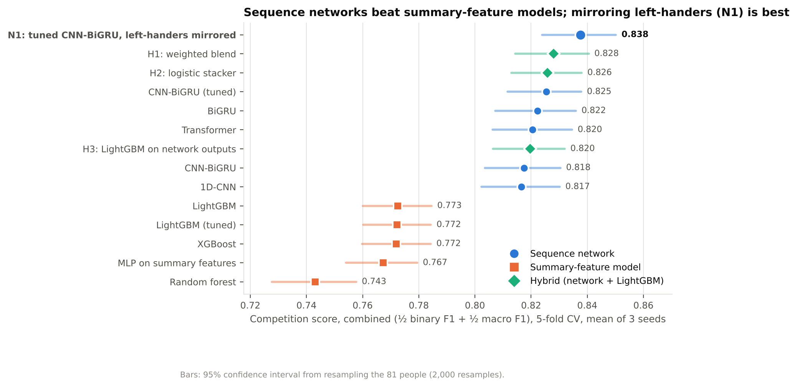

# Results: CMI – Detect Behavior with Sensor Data

**Final results:** 5-fold cross-validation by person, 3 seeds per model, 8,151 recordings from 81 people.
**Runs:** Kaggle, 2x Tesla T4, 24 Oct 2026. Pass 1 (seed 0, 324 min) and Pass 2 (seeds 1-2, ablations, N1, XGBoost, 205 min).

**Verified on 25 Oct 2026:**
- Every number below was recomputed from the raw out-of-fold predictions, and all 20 table rows match.
- Every statistical comparison was re-run and is byte-identical.
- Pass 2's seed-0 predictions are byte-identical to Pass 1's (reused, not retrained); seeds 1-2 are new.

Pass 1 is fully contained in these results. Its own logs are kept in `logs/pass1/`, and its stand-alone tables are in git history (commit `ea4a567`).

**Metric:** the competition score is ½ binary F1 (BFRB or not) + ½ macro F1 (8 BFRBs + non-target).
**Combined** applies it to the all-sensor and motion-only versions of every validation recording pooled. This
mirrors the hidden test set, where about half the recordings have motion (IMU) sensors only.

## Headline

| Model | All sensors | Motion only | **Combined [95% CI]** |
| --- | --- | --- | --- |
| **N1: tuned CNN-BiGRU, left-handed wearers mirrored** | **0.865** | **0.810** | **0.838** [0.824, 0.850] |
| H1: blend of tuned CNN-BiGRU + tuned LightGBM (deployed) | 0.862 | 0.794 | 0.828 [0.814, 0.841] |
| Tuned CNN-BiGRU | 0.857 | 0.794 | 0.825 [0.812, 0.838] |
| Best summary-feature model (LightGBM) | 0.805 | 0.741 | 0.773 [0.760, 0.785] |
| Shuffled labels (leakage check; chance is about 0.37-0.40) | 0.394 | 0.406 | 0.400 |

## Findings (each tested with a paired, person-level bootstrap and Holm correction)

| Question | Answer | Evidence |
| --- | --- | --- |
| Sequence vs summary features? | Sequence networks win by 0.045-0.08, every class, 5/5 folds. The MLP on summaries scores like the trees, so the representation matters, not the learner | `table_main`, `compare_main`, fig. 1, 4, 8 |
| Which architecture? | At default settings, BiGRU, CNN-BiGRU, CNN and Transformer are **not** significantly different | `compare_arch_default`, fig. 3 |
| Does tuning help? | Network: +0.008 (5/5 folds; +0.010 on fold 0, which tuning never saw). LightGBM: no gain | `table_tuning`, `compare_tuning_*`, fig. 11 |
| Do hybrids help? | H1 adds +0.003 (significant), all of it on all-sensor data. H2 ties H1. H3 is worse | `table_hybrids`, `compare_hybrids` |
| N1: mirror left-handers | **+0.012**, 5/5 folds; left-hander gap 0.081 → 0.019 | `table_n1`, `compare_n1`, fig. 6 |
| N2: phase auxiliary loss | No effect (-0.0004) | `compare_ablations`, fig. 3 |
| N3: dedicated motion-only model | +0.006, 5/5 folds | `compare_routing` |
| Augmentation / ToF regions | +0.011 / +0.004, both significant | `table_ablations`, `compare_ablations` |
| Seed averaging | +0.012-0.020 for every neural network, about 0 for trees | `seed_averaging`, fig. 7 |
| Ensembles (exploratory) | N1 + BiGRU + Transformer = 0.845 (+0.007 over N1) | `*_ensembles_exploratory`, fig. 10 |

## Figures (`figures/`, PNG for slides, PDF for the AAAI report)

| # | Figure | Shows |
| --- | --- | --- |
| 01 | Model comparison | Combined score + 95% CI for every model, by family |
| 02 | All sensors vs motion only | The cost of losing thermopile + ToF, per model |
| 03 | Effect of each component | Forest plot: N1/N2/N3, augmentation, tuning, ToF regions, blend, architecture |
| 04 | Per-class F1 | LightGBM vs tuned CNN-BiGRU vs N1, both sensor settings |
| 05 | Confusion matrix (N1) | Remaining confusions: eyebrow ↔ eyelash, neck pinch ↔ scratch |
| 06 | Handedness | Per-person slope chart: N1 lifts every left-hander |
| 07 | Seed averaging | Single seed vs 3-seed average |
| 08 | Binary vs macro F1 | Detecting a BFRB is solved; telling them apart is not |
| 09 | Posture | Lying on the side is hardest; N1 helps in every posture |
| 10 | Ensembles (exploratory) | Mixing architectures beats mixing views |
| 11 | Tuning history | Optuna trials, best-so-far, pruned trials |

Regenerate with `python -m models.report_figures` (reads only the CSVs here).

## Files

| File | Content |
| --- | --- |
| `table_*.csv` | Scores: full / imu / combined, 95% CI (`lo`, `hi`), fold 0 |
| `compare_*.csv` | Paired differences, 95% CI, bootstrap p, Holm-adjusted p, folds won |
| `analysis_<model>/` | Per-class F1, confusion matrices (+ PNG), per-person (with handedness), per-posture |
| `seed_averaging.csv`, `metric_breakdown.csv` | Per-seed scores, binary vs macro F1 |
| `params/` | Tuned settings + every Optuna trial |
| `blend_weights.json`, `deploy.json` | What the current submission uses: H1 with weight 0.60 (all sensors) / 0.80 (motion only) on the network |
| `folds_used.csv` | The person-to-fold split behind every number. Rebuilds reuse it automatically |
| `run_info.json` | Package versions, GPUs, settings, completed runs |
| `pipeline/` | Data-build evidence: unit tests, parity (377 recordings, max difference 0.0), 23/23 quality checks |
| `logs/` | Every job's log and the Kaggle console log for both passes |

## Caveats to state in the report

- **N1's mirror transform** was chosen by the team after inspecting all subjects' labels, though it is the physically expected mirror image. The comparison itself is otherwise clean: same folds, same model and settings, mirroring the only difference. The closing of the left-hander gap is independent evidence.
- **The ensemble results are exploratory:** chosen after seeing CV.
- **N1 is not deployed yet.** Its weights were not saved. The deployed submission is H1.
- **All of this is cross-validation.** The public leaderboard score comes from the submission.
- **The upside-down fix was not used:** it needs to know a person's ID, which isn't possible for new test people. The 2 upside-down wearers remain the 2 worst-scoring people.
