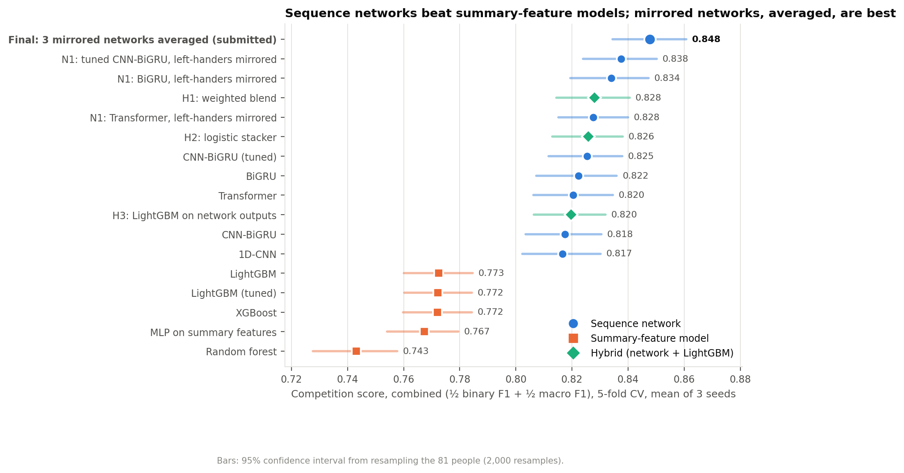

# Results: CMI – Detect Behavior with Sensor Data

**Final results:** 5-fold cross-validation by person, 3 seeds per model, 8,151 recordings from 81 people.
**Runs:** Kaggle, 2x Tesla T4. Pass 1 (24 Oct, seed 0), Pass 2 (24 Oct: seeds 1-2, ablations, N1, XGBoost) and
Pass 3 (27 Oct, 85 min: mirrored BiGRU and Transformer, the final ensemble and balancing, every submitted model saved).
Pass 3 left every earlier prediction byte-identical; retraining N1 to save its weights reproduced it exactly.

**Verified on 25 Oct 2026:**
- Every number here was recomputed from the raw out-of-fold predictions.
- Every statistical comparison was re-run and is byte-identical.
- Pass 2's seed-0 predictions are byte-identical to Pass 1's.

**Metric:** the competition score is ½ binary F1 (BFRB or not) + ½ macro F1 (8 BFRBs + non-target).
**Combined** applies it to the all-sensor and motion-only versions of every validation recording pooled. This
mirrors the hidden test set, where about half the recordings have motion (IMU) sensors only.
**CI** = 95% bootstrap over the 81 people. **"Significant"** = paired bootstrap, Holm-corrected within each family of comparisons.

| Model | All sensors | Motion only | **Combined [95% CI]** |
| --- | --- | --- | --- |
| **Final (submitted): N1 CNN-BiGRU + N1 BiGRU + N1 Transformer, averaged** | **0.879** | **0.816** | **0.848** [0.834, 0.861] |
| ... + per-person balancing (replayed test server, half motion-only) | | | 0.853 (vs 0.848 off) |
| N1: tuned CNN-BiGRU, left-handed wearers mirrored | 0.865 | 0.810 | 0.838 [0.824, 0.850] |
| H1: blend of tuned CNN-BiGRU + tuned LightGBM (first submission: public 0.844, private 0.823) | 0.862 | 0.794 | 0.828 [0.814, 0.841] |
| Tuned CNN-BiGRU | 0.857 | 0.794 | 0.825 [0.812, 0.838] |
| Best summary-feature model (LightGBM) | 0.805 | 0.741 | 0.773 [0.760, 0.785] |

## Layout: one folder per question, each with its tables and a `figures/` sub-folder

### 01_model_comparison: which model is best, and why?

| File | Content |
| --- | --- |
| `table_main.csv`, `compare_main.csv` | Every model's scores; the tuned CNN-BiGRU vs every other model |
| `compare_arch_default.csv` | The four architectures at equal (default) settings |
| `seed_averaging.csv`, `metric_breakdown.csv` | Single seed vs 3-seed average; binary F1 vs macro F1 |

Figures:
- `model_comparison`
- `all_sensors_vs_motion_only`
- `architecture_comparison`
- `binary_vs_macro_f1`
- `seed_averaging`

**Findings:**
- Sequence networks beat summary-feature models by 0.045-0.08, in 5/5 folds and on every class.
- The MLP on summaries scores like the trees, so the gain comes from reading the time series, not from the learner.
- At default settings the four architectures are statistically tied.
- Averaging 3 seeds adds +0.012-0.020 to every neural network and about 0 to trees.

### 02_hyperparameter_tuning: did tuning help, honestly?

| File | Content |
| --- | --- |
| `params/` | Selected settings (`*.json`) and every Optuna trial (`*_trials.csv`). The trainers read these |
| `table_tuning.csv`, `compare_tuning_nn.csv`, `compare_tuning_gb.csv` | Default vs tuned, including fold 0, which tuning never saw |

Figures:
- `tuning_history`
- `search_space`: each trial's score against each setting
- `default_vs_tuned`

**Protocol:** nested tuning. Optuna (TPE with median pruning) ran on 3 person-grouped inner folds built from outer
folds 1-4: 12 trials for the network, 20 for LightGBM.

**Findings:**
- The network gains +0.008 (5/5 folds) overall and +0.010 on the untouched fold 0.
- LightGBM gains nothing.
- The selected learning rate and width sit at the top of their search ranges.

### 03_ablations: what is each component worth?

| File | Content |
| --- | --- |
| `table_ablations.csv`, `compare_ablations.csv` | The default CNN-BiGRU without augmentation, without the phase loss (N2), and without the ToF 3x3 region features |
| `table_n1.csv`, `compare_n1.csv` | N1: each architecture trained on left-hand-mirrored data vs the same model unmirrored |
| `compare_routing.csv` | N3: dedicated motion-only model vs the all-sensor model with its sensors switched off |

Figures:
- `component_effects`: every effect with its CI and adjusted p
- `ablation_scores`
- `n1_handedness`

**Findings:**

| Component | Effect | Verdict |
| --- | --- | --- |
| N1: mirroring left-handed wearers | **+0.012** CNN-BiGRU, +0.012 BiGRU, +0.007 Transformer (all 5/5 folds); left-hander gap 0.081 → 0.019 | Largest single gain, on every architecture |
| Augmentation | +0.011 | Significant |
| N3: dedicated motion-only model | +0.006 | Significant |
| ToF 3x3 region features | +0.004 | Significant |
| N2: phase auxiliary loss | -0.0004 | No effect |

### 04_hybrids_and_ensembles: does combining models help?

| File | Content |
| --- | --- |
| `table_hybrids.csv`, `compare_hybrids.csv` | H1 weighted blend, H2 logistic stacker, H3 LightGBM on network outputs; all fitted on out-of-fold predictions only |
| `blend_weights.json` | H1 weights: 0.60 (all sensors) / 0.80 (motion only) on the network |
| `deploy.json` | What the submission runs (networks, tree model, weights, balancing strength, per-person quota) |
| `table_final.csv`, `compare_final.csv` | The final ensemble vs its three members, H1 and the tuned CNN-BiGRU |
| `table_balancing.csv` | Per-person balancing off vs on (strength chosen on other folds, 20 replays of the test server) |

Figures:
- `hybrids`
- `final_model`: the final ensemble vs its members, and balancing off vs on

**Findings:**
- H1 adds +0.003 (significant), all of it with all sensors.
- **Final ensemble: 0.848**, +0.010 over N1 alone, +0.020 over H1, +0.022 over the tuned CNN-BiGRU (all Holm-significant, 5/5 folds).
  Mixing architectures adds far more than mixing views (H1).
- **Balancing: +0.005** (0.848 → 0.853), strength 4 chosen on other folds in every fold, better in 20/20 replays and 5/5 folds.
- Checked on the Pass 2 predictions before choosing the final model (all fitted on other folds):
  - LightGBM on top of the 3-network average: 0.845 → 0.844, so the final model drops it.
  - Summing the 18 gesture probabilities into the 9 scored classes before the argmax: -0.005 (not used).
  - Per-class decision weights: +0.001 (not worth the extra fitting).
  - Per-person balancing: +0.006, better in 20/20 replays and 5/5 folds (used).

### 05_error_analysis: where do models still fail?

**Contents:** for each of the tuned CNN-BiGRU, tuned LightGBM, H1 and N1, a folder with per-class F1, confusion matrices
(all sensors and motion only), per-person scores (with handedness) and per-posture scores.

Figures:
- `per_class_f1`
- `confusion_matrix_n1`
- `posture`

**Findings:**
- The hardest pair is eyebrow vs eyelash pulling, followed by neck pinch vs neck scratch.
- Losing thermopile + ToF hurts cheek pinch, above-ear pull and neck pinch most.
- Lying on the non-dominant side is the hardest posture.
- The 2 upside-down wearers remain the 2 worst-scoring people.

### 06_validation: can the numbers be trusted?

| File | Content |
| --- | --- |
| `table_sanity.csv` | Shuffled-label controls: 0.40-0.41, at chance for this metric (about 0.37-0.40) |
| `folds_used.csv` | The person-to-fold split behind every number. Every rebuild reuses it |
| `run_info.json` | Package versions, GPUs, settings, completed runs |
| `pipeline/` | Data-build evidence: unit tests, parity (377 recordings, max difference 0.0), 23/23 quality checks |

Figure: `sanity_check`

Regenerate every figure with `python -m models.report_figures` (it reads only the CSVs here).

## Caveats to state in the report

- **N1's mirror transform** was chosen by the team after inspecting all subjects' labels, though it is the physically expected mirror image. The comparison is otherwise clean: same folds, model and settings, with mirroring the only difference.
- **The final ensemble's membership** was chosen after exploratory ensembles on Pass 2 predictions, then fixed before
  Pass 3 trained it. Its score is therefore mildly optimistic; the leaderboard is the independent check.
- **Balancing** relies on every test participant following the training protocol (8 of each BFRB per person).
  It uses only the person's earlier predictions, never labels.
- **All of this is cross-validation.** The leaderboard score comes from the Kaggle submission.
